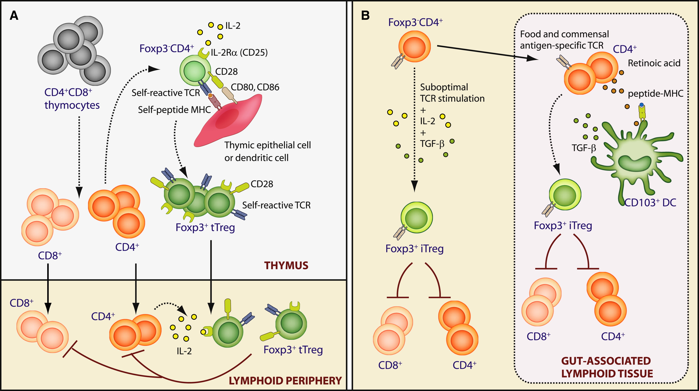
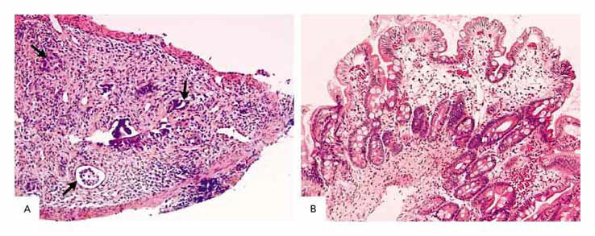
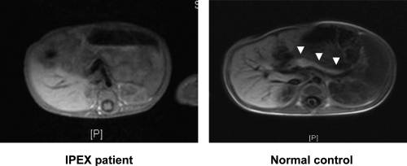
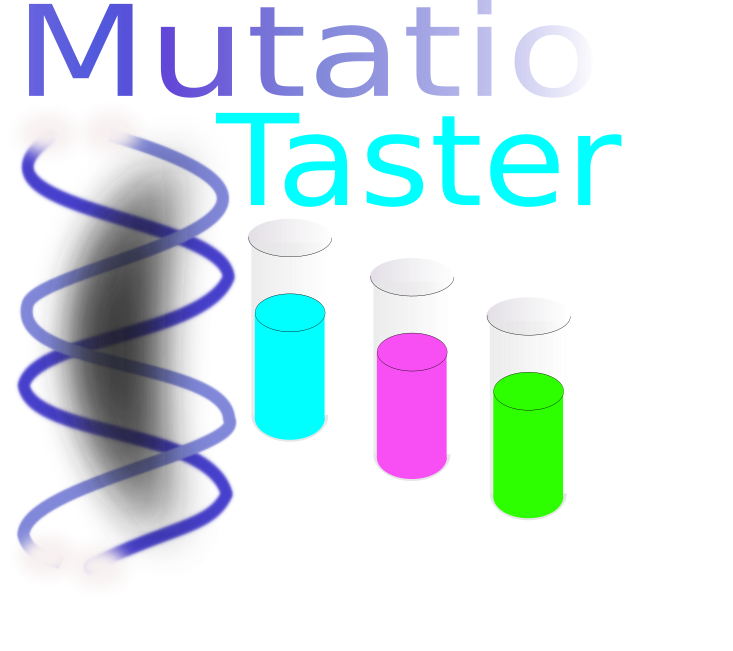
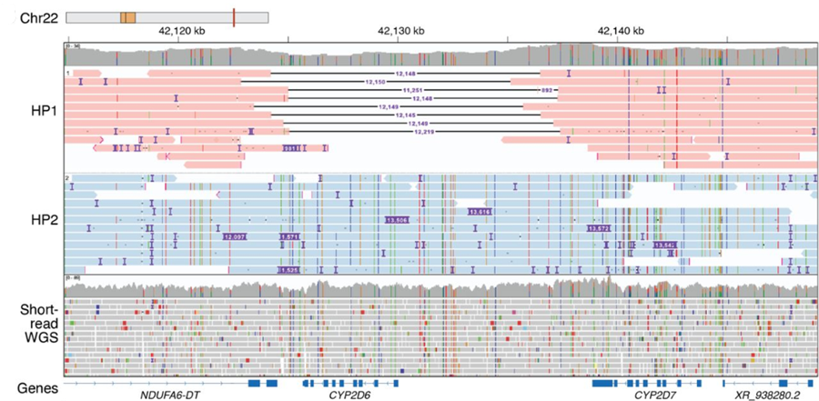

## FOXP3

:::::: {.columns}

::::: {.column width="45%"}

::: {.step-card}
**Protein family** 
A member of the fork-winged helix family of transcription factors
:::

::: {.step-card .goal}
**Function** 

Important for the development and function of naturally occurring CD4+/CD25+ T regulatory cells (Tregs)
:::

:::::

::::: {.column width="55%"}
{.shadow-img fig-align="center"}
:::::

::::::

::: {.tiny-credit}
Josefowicz SZ, Rudensky A. (2009) [Control of regulatory T cell lineage commitment and maintenance. _Immunity_ **30**:616-25](https://pubmed.ncbi.nlm.nih.gov/19464984/)
:::

## HPO

::: {.step-card .goal}
**Disease annotated with HPO terms** 
[Immunodysregulation, polyendocrinopathy, and enteropathy, X-linked](https://hpo.jax.org/browse/disease/OMIM:304790)
:::

{.shadow-img fig-align="center" width="80%"}

## Small intestine

:::::: {.columns}

::::: {.column width="50%"}
<iframe data-src="../widgets/hra-smallweb-small-intestine.html" width="70%" height="320" style="border:none;"></iframe>

::: {.step-card}
Human Reference Atlas Small Intestine
:::
:::::

::::: {.column width="50%"}
{.shadow-img fig-align="center"}

::: {.step-card .goal}
A duodenal-biopsy specimen:  a flattened mucosa with absent or necrotic crypts
:::
:::::

::::::

::: {.step-card .goal}
* [Villous atrophy (HP:0011473)](https://hpo.jax.org/browse/term/HP:0011473)
:::

## Pancreas

:::::: {.columns}

::::: {.column width="50%"}
<iframe data-src="../widgets/hra-smallweb-pancreas.html" width="70%" height="320" style="border:none;"></iframe>

::: {.step-card}
Human Reference Atlas Pancreas
:::
:::::

::::: {.column width="50%"}
{.shadow-img fig-align="center"}

::: {.step-card .goal}
Absence of recognizable pancreatic tissue  of a patient with classic IPEX syndrome (c.227delT, p.Leu74GlnfsX53 mutation).
:::
:::::

::::::

::: {.step-card .goal}
* [Type I diabetes mellitus (HP:0100651)](https://hpo.jax.org/browse/term/HP:0100651)
:::

::: {.tiny-credit}
image: [Rubio-Cabezas O, et al. (2009) Clinical heterogeneity in patients with FOXP3 mutations presenting with permanent neonatal diabetes. _Diabetes Care_ **32**:111-6](https://pubmed.ncbi.nlm.nih.gov/18931102/)
:::

## Skin

:::::: {.columns}

::::: {.column width="65%"}
<iframe data-src="../widgets/hra-viewer-skin.html" width="100%" height="520" style="border:none;"></iframe>
:::::

::::: {.column width="35%"}

::: {.step-card .goal}
**HPO term** 
[Eczematoid dermatitis HP:0000964](https://hpo.jax.org/browse/term/HP:0000964)
:::

:::::

::::::

## NM_014009.4(FOXP3):c.1112T>G (p.Phe371Cys)

:::::: {.columns}

::::: {.column width="30%"}
{.shadow-img width="100%" fig-align="center"}
:::::

::::: {.column width="70%"}

::: {.step-card .goal}
**Predicted effect** 
[Open the MutationTaster result](https://teide.charite.de/MT2021/MutationTaster102.cgi?gene=foxp3&transcript_stable_id_text=ENST00000376207&transcript_stable_id_radio=ENST00000376207&new_base=A&sequence_type=CDS&position_be=1150)
:::

:::::

::::::

## What would a neutral variant look like?

:::::: {.columns}

::::: {.column width="45%"}
{.shadow-img fig-align="center"}
:::::

::::: {.column width="55%"}

::: {.step-card .warn}
Every individual has between 4-5 million variants, the vast majority of which are benign. But how do we know they are benign?
:::

::: {.step-card .goal}
[MutationTaster: benign, c.155G>T / G52V](https://teide.charite.de/MT2021/MutationTaster102.cgi?transcript_stable_id_text=ENST00000376207&alteration_name=2349114808CA_6_ENST00000376207&bases_inserted=T&sequence_type=gDNA&end_insdel=6482&start_insdel=6480)^[NM_014009/ENST00000376207.4 / chr23:49114808C>A (GRCh37)]
:::

:::::

::::::

