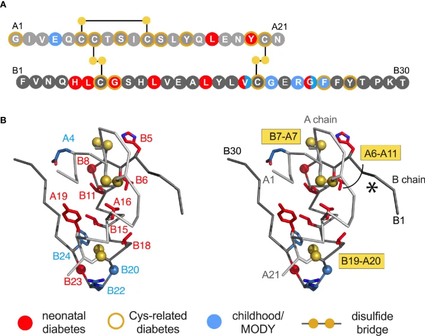

## INS

:::::: {.columns}

::::: {.column width="45%"}

::: {.step-card}
**Protein** 
INS codes for Proinsulin, which is converted to insulin by the enzymatic removal of a segment that connects the amino end of the A chain to the carboxyl end of the B chain. 
:::

::: {.step-card .goal}
**Function** 

Mutations in _INS_ lead to [Diabetes mellitus, permanent neonatal 4](https://omim.org/entry/176730) and related genetic diseases
:::

:::::

::::: {.column width="55%"}
{.shadow-img fig-align="center"}
:::::

::::::

::: {.tiny-credit}
Image: Dhayalan B, et al. (2021) [Structural Lessons From the Mutant Proinsulin Syndrome. _Front Endocrinol (Lausanne)_ **12**:754693](https://pubmed.ncbi.nlm.nih.gov/34659132/)
:::

## HPO

::: {.step-card .goal}
**Disease annotated with HPO terms** 
[Diabetes mellitus, permanent neonatal 4](https://hpo.jax.org/browse/disease/OMIM:618858)
:::

{.shadow-img fig-align="center" width="80%"}

## Pancreas

:::::: {.columns}

::::: {.column width="50%"}
<iframe data-src="../widgets/hra-smallweb-pancreas.html" width="70%" height="320" style="border:none;"></iframe>

::: {.step-card}
Human Reference Atlas Pancreas
:::
:::::

::::: {.column width="50%"}
{.shadow-img fig-align="center"}

::: {.step-card .goal}
Misfolding of mutant Proinsulin leads to lack of mature insulin in circulation
:::
:::::

::::::

::: {.step-card .goal}
* [Type I diabetes mellitus (HP:0100651)](https://hpo.jax.org/browse/term/HP:0100651)
:::

::: {.tiny-credit}
image: [Rubio-Cabezas O, et al. (2009) Clinical heterogeneity in patients with FOXP3 mutations presenting with permanent neonatal diabetes. _Diabetes Care_ **32**:111-6](https://pubmed.ncbi.nlm.nih.gov/18931102/)
:::

## NM_000207.3(INS):c.292A>T (p.Ser98Cys)

:::::: {.columns}

::::: {.column width="30%"}
{.shadow-img width="100%" fig-align="center"}
:::::

::::: {.column width="70%"}

::: {.step-card .goal}
**Predicted effect** 
[Open the MutationTaster result](https://teide.charite.de/MT2021/MutationTaster102.cgi?new_base=T&position_be=292&gene=ins&transcript_stable_id_radio=ENST00000397262&sequence_type=CDS&transcript_stable_id_text=ENST00000397262)
:::

:::::

::::::
