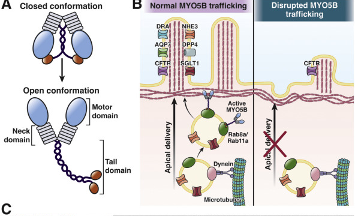
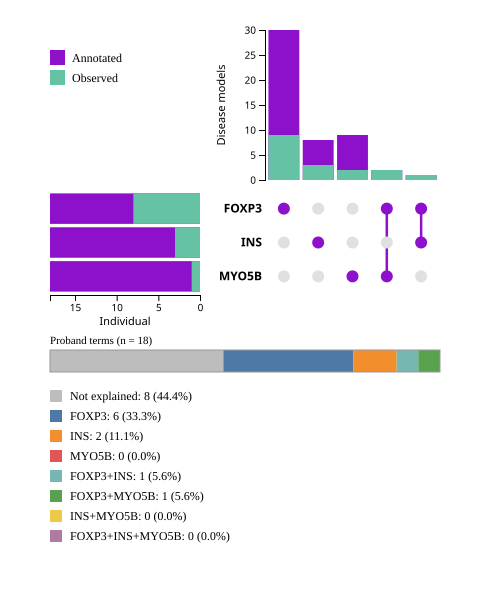
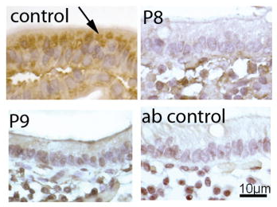

## MYO5B

:::::: {.columns}

::::: {.column width="45%"}

::: {.step-card}
**Protein family** 
MYO5B is an actin filament-based motor protein that binds select GTPase RAB proteins, including RAB8 
:::

::: {.step-card .goal}
**Function** 

Dysfunction of MYO5B leads to  lack of microvilli on the surface of enterocytes and occurrence of intracellular vacuolar structures containing microvilli. 
:::

:::::

::::: {.column width="55%"}
{.shadow-img fig-align="center"}
:::::

::::::

::: {.tiny-credit}
Image: Bowman DM, et al. (2022) [Altered MYO5B Function Underlies Microvillus Inclusion Disease: Opportunities for Intervention at a Cellular Level. _Cell Mol Gastroenterol Hepatol_ **14**:553-565](https://pubmed.ncbi.nlm.nih.gov/35660026/)
:::

## HPO

::: {.step-card .goal}
**Disease annotated with HPO terms** 
[Diarrhea 2, with microvillus atrophy, with or without cholestasis](https://hpo.jax.org/browse/disease/OMIM:251850)
:::

{.shadow-img fig-align="center" width="80%"}

## Small intestine

:::::: {.columns}

::::: {.column width="50%"}
<iframe data-src="../widgets/hra-smallweb-small-intestine.html" width="70%" height="320" style="border:none;"></iframe>

::: {.step-card}
Human Reference Atlas Small Intestine
:::
:::::

::::: {.column width="50%"}
{.shadow-img fig-align="center"}

::: {.step-card .goal}
 No or little specific myosin Vb signal is detected in the enterocytes of patients with DIAR2
:::
:::::

::::::

::: {.step-card .goal}
* [Villous atrophy (HP:0011473)](https://hpo.jax.org/browse/term/HP:0011473)
:::

## NM_001080467.3(MYO5B):c.3841_3842delinsAA (p.Ala1281Lys)

:::::: {.columns}

::::: {.column width="30%"}
{.shadow-img width="100%" fig-align="center"}
:::::

::::: {.column width="70%"}

::: {.step-card .goal}
**Predicted effect** 
[Open the MutationTaster result](https://teide.charite.de/MT2021/MutationTaster102.cgi?gene=MYO5B&start_insdel=3840&bases_inserted=TT&end_insdel=3843&sequence_type=CDS&transcript_stable_id_text=ENST00000285039)
:::

:::::

::::::
