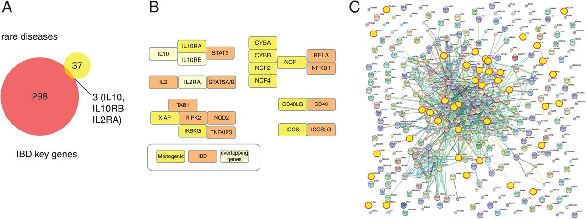
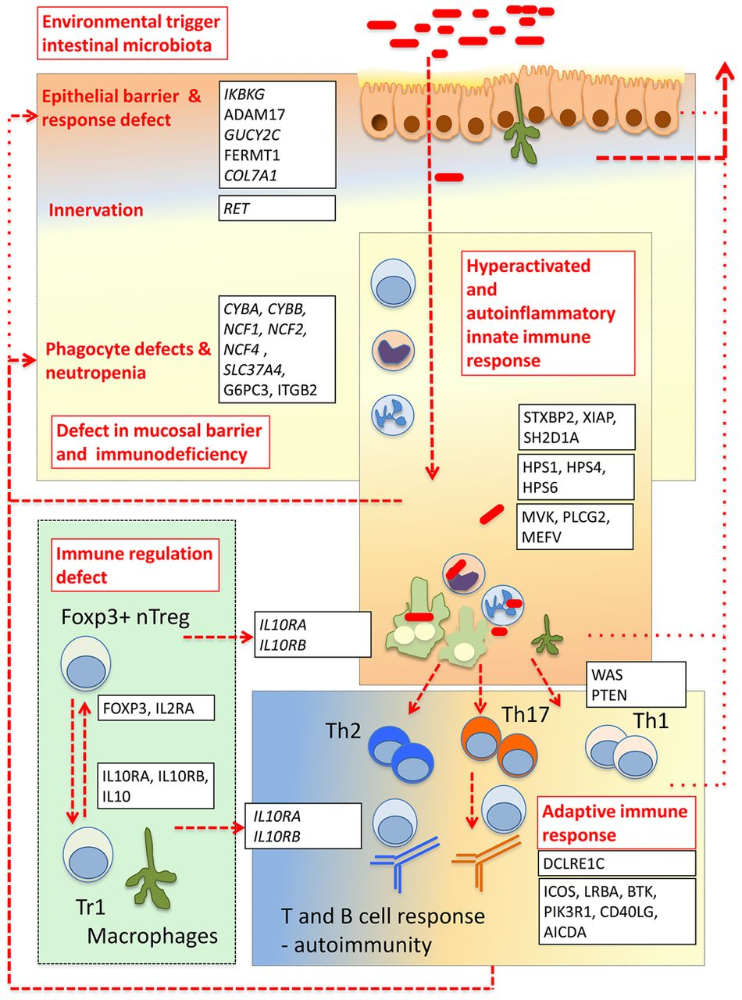

## Background

::: {.callout-note icon=false}
**Data-Driven Differential Diagnosis in Human Genetics**

- In today's presentation we will show how human genetics uses data science and genomics to support differential Diagnostics
- The overall diagnostic rate in human genetics has improved by roughly 300% in the last two decades
- We will show an example of a patient with a Mendelian mimic of inflammatory bowel disease^[chronisch-entzündliche Darmerkrankung (abgekürzt CED)]
:::

## IBD: Rare and common

{width="70%" fig-align="center"}

* There are many different diseases characterized by inflammation in the gut
    - Common intestinal infections that nearly everyone gets once in a while
    - Crohn disease (CD) and ulcerative colitis (UC), together terms inflammatory bowel disease (IBD), ca. 1:200 individuals
    - In addition to IBD there are an increasing number of monogenic diseases that can present with IBD-like immunopathology.     
    - Rare genetic diseases (inborn errors of immunity, IEI) that can display severe, often early-onset manifestations similar to IBD

::: {.tiny-credit}
image: Uhlig HH. Monogenic diseases associated with intestinal inflammation: implications for the understanding of inflammatory bowel disease. Gut. 2013  PMID: 24203055.
:::

## IBD: Pathways

{width="70%" fig-align="center"}

* Pathway interaction between key genes associated with inflammatory bowel disease (IBD) and IBD-like monogenic disorders.
* Understanding rare diseases with IBD-like features may provide insight for treating common forms

::: {.tiny-credit}
image: Uhlig HH. Monogenic diseases associated with intestinal inflammation: implications for the understanding of inflammatory bowel disease. Gut. 2013  PMID: 24203055.
:::

## IBD: Pathophysiology

- Model of key intestinal defence functions and cellular immune regulation components that are impaired in monogenic disorders with inflammatory bowel disease (IBD)-like phenotype.
- Genetic defects that affect epithelial barrier and response, neutrophil numbers, phagocytosis and bacterial killing, as well as gut innervation lead to increased intestinal bacterial translocation across the epithelial barrier and bacterial survival. 

{width="70%" fig-align="center"}

::: {.tiny-credit}
image: Uhlig HH. Monogenic diseases associated with intestinal inflammation: implications for the understanding of inflammatory bowel disease. Gut. 2013  PMID: 24203055.
:::

## Rare in common

- Amongst 1480 participants with inflammatory bowel disease from five clinical trials 70 (4.73%), respectively,
had pathogenic or likely pathogenic variants in a relevant gene.  
- 31 of 33 participants who had received a diagnosis of inflammatory bowel disease but carried a rare disease-causing variant showed no or only a short-term response to adalimumab, a tumor necrosis factor α  inhibitor approved by the Food and Drug Administration for the treatment of Crohn’s disease and ulcerative colitis.
-  Nevertheless, in clinical practice, rare forms of common disease may be difficult to recognize. 
- **misdiagnoses of rare diseases as common ones are not infrequent**. 

* [Rahimov F, et al. (2025) Common Diseases in Clinical Cohorts - Not Always What They Seem. _N Engl J Med_ **393**:1589-1598](https://pubmed.ncbi.nlm.nih.gov/41124632/)
* [Robinson PN (2025) A Rare-in-Common Paradigm for Precision Genomic Medicine. _N Engl J Med_ **393**:1648-1649](https://pubmed.ncbi.nlm.nih.gov/41124636/)
