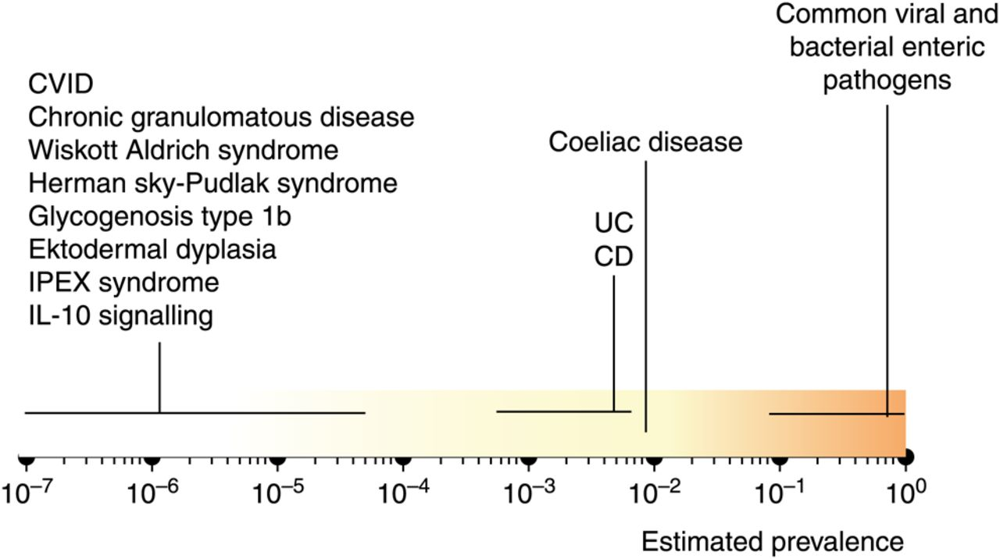

## Background

::: {.callout-note icon=false}
**Data-Driven Differential Diagnosis in Human Genetics**

- In today's presentation we will show how human genetics uses data science and genomics to support differential Diagnostics
- The overall diagnostic rate in human genetics has improved by roughly 300% in the last two decades
- We will show how this was made possible using an example of a patient with inflammatory bowel disease^[chronisch-entzündliche Darmerkrankung (abgekürzt CED)]
:::

## IBD: Rare and common

{width="70%" fig-align="center"}

* There are many different diseases characterized by inflammation in the gut
    - Common intestinal infections that nearly everyone gets once in a while
    - Crohn disease (CD) and ulcerative colitis (UC), together terms inflammatory bowel disease (IBD), ca. 1:200 individuals
    - In addition to IBD there are an increasing number of monogenic diseases that can present with IBD-like immunopathology. The prevalence of these monogenic diseases is very low compared with common intestinal infections, coeliac disease or IBD. As a group, these monogenic defects are associated with high morbidity and even mortality. Due to their clear functional impact, these prototypic ‘orphan’ diseases can inform on functional mechanisms that predispose to intestinal inflammation. Indeed, there is increasing awareness that some aspects of the immune dysfunction in IBD may have similarities to those seen in rare monogenic diseases.
    - Rare genetic diseases (inborn errors of immunity, IEI) that can display severe, often early-onset manifestations similar to IBD

::: {.tiny-credit}
image: Uhlig HH. Monogenic diseases associated with intestinal inflammation: implications for the understanding of inflammatory bowel disease. Gut. 2013  PMID: 24203055.
:::

## IBD: Pathways

{width="70%" fig-align="center"}

* Pathway interaction between key genes associated with inflammatory bowel disease (IBD) and IBD-like monogenic disorders.
* Understanding rare diseases with IBD-like features may provide insight for treating common forms

::: {.tiny-credit}
image: Uhlig HH. Monogenic diseases associated with intestinal inflammation: implications for the understanding of inflammatory bowel disease. Gut. 2013  PMID: 24203055.
:::

## Todo

- To be finalized: Add a few more background slides in case somebody has questions