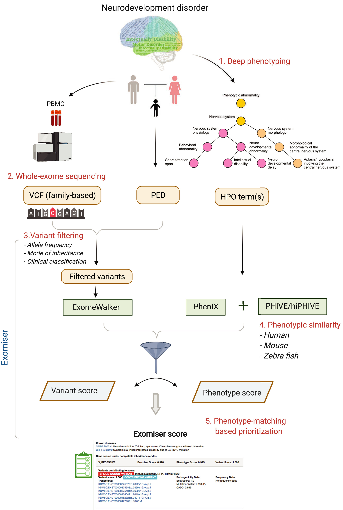
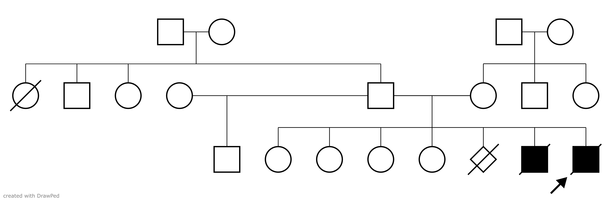
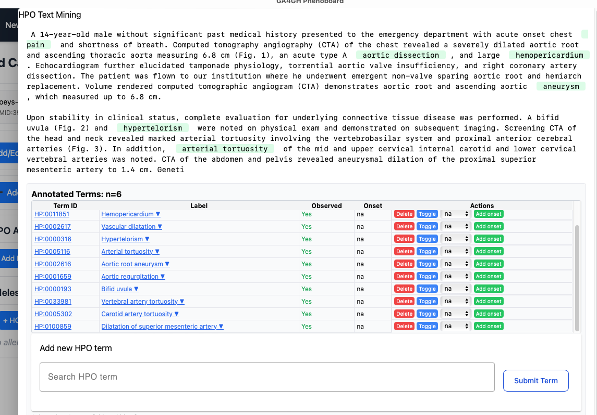
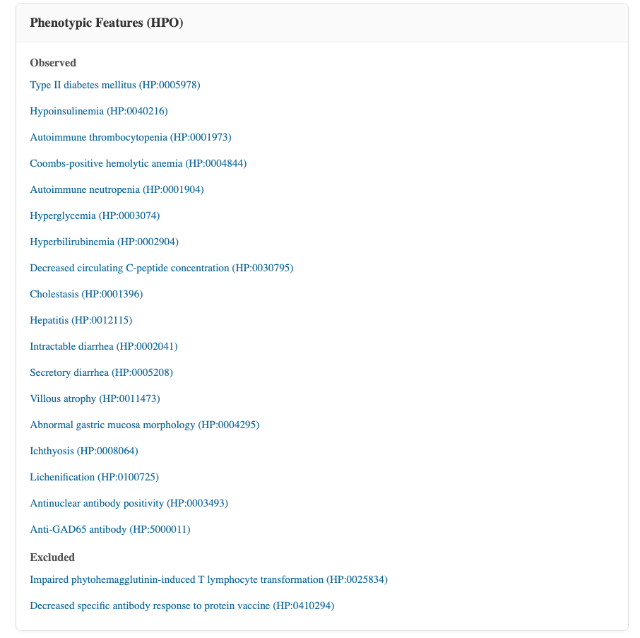

## Genetic diagnostics {.center-title}

::: {.question}
How do clinicians make a diagnosis of genetic disease?
:::

:::: {.columns}

::: {.column width="62%"}

::: {.step-card .fragment}
**1 · Deep phenotyping** 
Detailed clinical examination
:::

::: {.step-card .fragment}
**2 · Integrate the evidence** 
Signs, symptoms, lab values, imaging, set against:
anatomy
biochemistry
genetics
physiology
:::

::: {.step-card .warn .fragment}
**The bottleneck** 
Assembling all the needed information is difficult and time-consuming
:::

::: {.step-card .goal .fragment}
**The HRA–HPO bridge** + MutationTaster 
streamlines data integration for clinical diagnostics
:::

::: {.tiny-credit}
Wang Q, et al. (2022) [Deep phenotyping and whole-exome sequencing improved the diagnostic yield for nuclear pedigrees with neurodevelopmental disorders. Mol Genet Genomic Med. 2022 May;10(5):e1918](https://pubmed.ncbi.nlm.nih.gov/35266334/)
:::

:::

::: {.column width="38%"}
{.shadow-img fig-align="center"}
:::

::::

## IPEX syndrome

::: {.question}
What can a published IPEX case report teach us about data-driven diagnosis?
:::

::: {.step-card}
**The disease** 
[Immune dysregulation, polyendocrinopathy, enteropathy, X-linked syndrome (IPEX)](https://omim.org/entry/304790)
:::

::: {.step-card .goal}
**The defect** 
A prototypic defect in the natural regulatory T cell compartment, leading to immunodeficiency, autoimmunity, enteropathy and colitis
:::

::: {.step-card}
**The gene** 
Many IPEX patients have defects in the transcription factor *FOXP3*, which determines the fate and immunosuppressive activity of natural and some induced regulatory T cells
:::

::: {.tiny-credit}
Source of the clinical data: Baud O, et al. (2001) [Treatment of the immune dysregulation, polyendocrinopathy, enteropathy, X-linked syndrome (IPEX) by allogeneic bone marrow transplantation. _N Engl J Med_ **344**:1758-62](https://pubmed.ncbi.nlm.nih.gov/11396442/)
:::

## Family history

:::::: {.columns}

::::: {.column width="50%"}
{.shadow-img fig-align="center"}
:::::

::::: {.column width="50%"}

::: {.step-card}
**Mother** 
Unexplained spontaneous abortion in the fourth month of one pregnancy
:::

::: {.step-card}
**Four healthy daughters** 
Aged 11, 16, 18 and 19
:::

::: {.step-card .warn}
**One son, died at 4.5 months** 
Intractable diarrhea, thrombocytopenia, insulin-dependent diabetes mellitus, ichthyosiform dermatitis. Duodenal biopsy: villous atrophy. Autopsy: lymphocyte and plasmocyte infiltration of liver, small bowel, colon and pancreas
:::

::: {.step-card .goal}
No diagnosis was made at the time
:::

:::::

::::::

## Coding data as HPO

{.shadow-img fig-align="center"}

## Phenoboard: IPEX Textmining results

{.shadow-img fig-align="center"}

## Differential diagnosis: SAMS

::: {.step-card .goal}
**[Differential diagnosis (SAMS)](https://www.genecascade.org/sams-cgi/phenotype.cgi?phenotype=*HP1873%7C*HP8064%7C*HP100651%7C*HP964%7C*HP2041%7C&age_of_onset=Neonatal%7C&moi=X-linked%20recessive%7C)** 
Ranked candidate diagnoses from the patient's HPO terms
:::

::: {.tiny-credit}
Steinhaus R, et al. (2022) Deep phenotyping: symptom annotation made simple with SAMS. _Nucleic Acids Res_ **50**:W677-W681. [PMID 35524573](https://pubmed.ncbi.nlm.nih.gov/35524573/)
:::