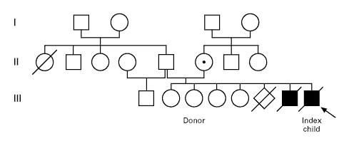

## Genetic diagnostics {.center-title}

::: {.question}
How do clinicians make a diagnosis of genetic disease?
:::

:::: {.columns}

::: {.column width="62%"}

::: {.step-card .fragment}
**1 · Deep phenotyping** 
Detailed clinical examination
:::

::: {.step-card .fragment}
**2 · Integrate the evidence** 
Signs, symptoms, lab values, imaging, set against:
anatomy
biochemistry
genetics
physiology
:::

::: {.step-card .warn .fragment}
**The bottleneck** 
Assembling all the needed information is difficult and time-consuming
:::

::: {.step-card .goal .fragment}
**The HRA–HPO bridge** + MutationTaster 
streamlines data integration for clinical diagnostics
:::

::: {.tiny-credit}
Wang Q, et al. (2022) [Deep phenotyping and whole-exome sequencing improved the diagnostic yield for nuclear pedigrees with neurodevelopmental disorders. Mol Genet Genomic Med. 2022 May;10(5):e1918](https://pubmed.ncbi.nlm.nih.gov/35266334/)
:::

:::

::: {.column width="38%"}
{.shadow-img fig-align="center"}
:::

::::

## IPEX syndrome

We will leverage information from a published report about individuals with 
[Immune dysregulation, polyendocrinopathy, enteropathy, X linked syndrome (IPEX)](https://omim.org/entry/304790) to illustrate processes in data-driven genetic diagnostics.

* IPEX represents a prototypic defect in the natural regulatory T cell compartment, leading to immunodeficiency and autoimmunity, but also enteropathy and colitis.
* A substantial proportion of IPEX patients have defects in the transcription factor FOXP3 that determines the fate and immunosuppressive activity of natural and a part of induced regulatory T cells. 

The source for the clinical data:

* Baud O, et al. (2001) [Treatment of the immune dysregulation, polyendocrinopathy, enteropathy, X-linked syndrome (IPEX) by allogeneic bone marrow transplantation. _N Engl J Med_ **344**:1758-62](https://pubmed.ncbi.nlm.nih.gov/11396442/)

## Family history

{.shadow-img fig-align="center"}

- The mother  had had an unexplained spontaneous abortion during the fourth month of one pregnancy
- She had four healthy daughters who were 11, 16, 18, and 19 years old. 
- One son had died at 4.5 months of age from intractable diarrhea, thrombocytopenia, insulin-dependent diabetes mellitus, and ichthyosiform dermatitis. 
- A biopsy of the duodenal mucous membrane from this child showed villous atrophy, and autopsy showed infiltration by lymphocytes and plasmocytes of the liver, small bowel, colon, and pancreas.
- No diagnosis was made at the time

## Coding data as HPO

{.shadow-img fig-align="center"}

## Phenoboard: IPEX Textmining results

{.shadow-img fig-align="center"}

## Differential diagnosis: SAMS

- [Differential diagnosis (SAMS)](https://www.genecascade.org/sams-cgi/phenotype.cgi?phenotype=*HP5978%7C*HP40216%7C*HP1873%7C*HP4844%7C)

- [Steinhaus R, et al. (2022) Deep phenotyping: symptom annotation made simple with SAMS. _Nucleic Acids Res_ **50**:W677-W681](https://pubmed.ncbi.nlm.nih.gov/35524573/)
